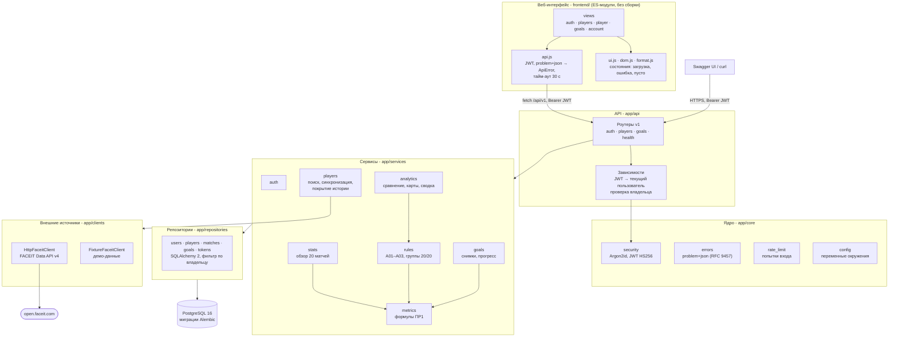
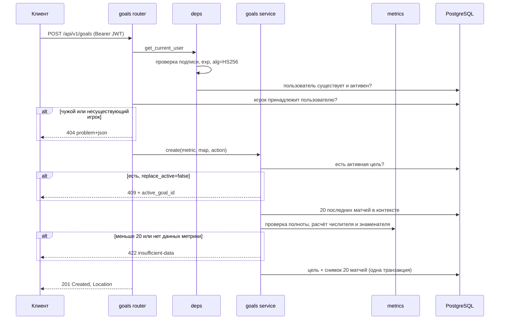
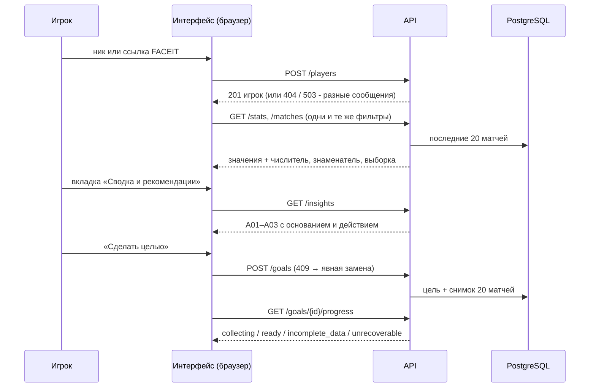

# Архитектура FACEIT Progress

## Слои

Каждый слой обращается только к слою ниже. Роутеры не работают с БД напрямую:
они проверяют входные данные (Pydantic), вызывают сервис и преобразуют результат в схему ответа.
Интерфейс ничего не считает сам: все показатели, пороги и тексты выводов приходят из API,
поэтому обзор, сравнение и цель используют одни и те же формулы (NFR08).

| Слой | Каталог | Ответственность |
|---|---|---|
| Интерфейс | `frontend/` | Экраны, маршрутизация по hash, состояния загрузки/ошибки/пусто, адаптив 360–1440 px |
| API | `app/api` | Маршруты, коды ответов, валидация параметров, аутентификация, проверка владельца |
| Схемы | `app/schemas` | Контракт запросов и ответов; из них FastAPI строит OpenAPI |
| Сервисы | `app/services` | Бизнес-правила: формулы, пороги, правила A01–A03, снимки целей, покрытие истории. `rules.py` не зависит от БД и тестируется отдельно |
| Репозитории | `app/repositories` | Запросы к БД; фильтр `user_id` стоит в каждом запросе к пользовательским данным |
| Модели | `app/models` | Таблицы SQLAlchemy и ограничения целостности |
| Клиенты | `app/clients` | Доступ к FACEIT; без ключа API - детерминированные демо-данные |
| Ядро | `app/core` | Настройки, безопасность, формат ошибок |

## Путь запроса: постановка цели

## Путь пользователя в интерфейсе

Переход между страницами отменяет незавершённые запросы прошлой страницы (`AbortController`),
поэтому при быстром поиске двух игроков на экране не остаются показатели предыдущего (S01, крит. 6).
Ответ 401 очищает сессию и возвращает на вход с сохранением адреса.

## Решения и их причины

**Игроки принадлежат пользователю.** Таблица `players` содержит `user_id`. Это упрощает
проверку доступа: чужой игрок не находится тем же запросом, что и несуществующий, и API
отвечает одинаковым 404. Дублирование матчей у разных пользователей для учебного объёма некритично.

**Снимки целей хранятся копией.** `goal_snapshot_matches` не ссылается на `matches`.
Обновление или удаление истории не меняет исходную выборку и готовое сравнение (ПР1, раздел 2.2).

**Итог метрики без округления.** В цели хранятся числитель и знаменатель
(`baseline_numerator/denominator`), значение вычисляется при выдаче. Округление влияет
только на отображение.

**Покрытие истории.** FACEIT отдаёт не больше 100 последних матчей. При каждой синхронизации
сервис проверяет, пересекается ли новая порция с сохранённой. Если не пересекается,
`coverage_from` сдвигается и цель, начатая раньше, получает статус `unrecoverable`.
Последние матчи не подставляются вместо пропущенных первых.

**Интерфейс без сборки.** Статические ES-модули раздаются тем же процессом FastAPI. Нет шага
сборки, Node.js нужен только для линтера в CI, а API и интерфейс находятся на одном origin -
не нужны CORS и хранение токена в cookie. DOM строится функцией `h()` только через `textContent`;
ESLint запрещает `innerHTML` и `eval`.

**Отзыв токенов.** JWT остаётся без состояния, но при выходе его `jti` записывается в
`revoked_tokens` до момента `exp`. Проверка - один запрос по первичному ключу; истёкшие записи
удаляются при следующем выходе.

**Демо-данные вместо FACEIT.** Пока ключ FACEIT не получен, `FixtureFaceitClient` выдаёт
вымышленные детерминированные профили. Они нужны для тестов, локальной разработки и защиты.
С ключом в `.env` тот же код работает с настоящим API.

## Изменения относительно ПР1

| ПР1 | Сейчас | Причина |
|---|---|---|
| Без аккаунтов; цель и снимки хранятся в браузере (NFR07) | Регистрация, JWT, цели и снимки в PostgreSQL | Задание ПР2 требует CRUD с аутентификацией. Заодно снято ограничение «только в том же браузере» |
| Одна активная цель на браузер | Одна активная цель на пользователя (частичный уникальный индекс) | Следствие перехода на аккаунты |
| Проверка динамики - R3 | Реализована на сервере: `GET /goals/{id}/progress` | Цели - основная сущность CRUD; правила сохранения выборок нужны уже при создании цели |
| Сравнение 20 / 20, карты и правила A01–A03 - R2 | Реализованы: `/compare`, `/maps`, `/insights` | Нужны для полного пользовательского сценария «обзор → вывод → действие → цель» |
| Веб-интерфейс на телефоне и компьютере (S05) | Адаптивный интерфейс в `frontend/`, проверен e2e-тестами на 360, 768 и 1440 px | Критерий «Интеграция и UI» |
| - | Выход из аккаунта с отзывом токена | Снято ограничение «нет отзыва токена» |
