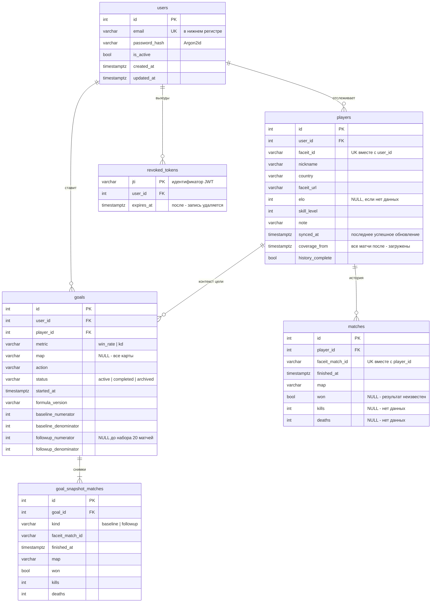

# Схема базы данных

PostgreSQL 16. Схема создаётся миграциями `alembic/versions/0001_initial.py` и
`0002_revoked_tokens.py` (отозванные токены для выхода из аккаунта).
Тест `tests/api/test_contract.py::test_migrations_match_models` проверяет, что миграция
совпадает с моделями SQLAlchemy.

## Ограничения целостности

| Ограничение | Таблица | Что обеспечивает | Требование ПР1 |
|---|---|---|---|
| `uq_users_email` | users | Один аккаунт на email | - |
| `uq_players_user_faceit` | players | Игрок не добавляется пользователем дважды | S01 |
| `uq_matches_player_match` | matches | Матч не попадает в историю дважды; синхронизация делает upsert | S07, сбой 10.2 |
| `ck_matches_kills/deaths_non_negative` | matches | Отрицательная статистика отклоняется | NFR08 |
| `uq_goals_one_active_per_user` (частичный: `WHERE status = 'active'`) | goals | Одновременно активна одна цель, в том числе при параллельных запросах | S11, критерий 3 |
| `ck_goals_metric_allowed`, `ck_goals_status_allowed` | goals | Только допустимые метрики и статусы | S11 |
| `uq_goal_snapshot_match` | goal_snapshot_matches | Матч входит в снимок один раз | S11, S12 |
| `pk_revoked_tokens (jti)` | revoked_tokens | Токен отзывается один раз; повторный выход не создаёт дубль | - |
| `ON DELETE CASCADE` на всех FK | все | Удаление аккаунта или игрока удаляет зависимые данные без «сирот» | - |

## Индексы

| Индекс | Используется в запросах |
|---|---|
| `ix_matches_player_finished (player_id, finished_at)` | Обзор, история с фильтром периода, выборки цели до и после `started_at` |
| `ix_players_user_id`, `ix_goals_user_id` | Списки ресурсов пользователя |
| `ix_goals_player_id`, `ix_goal_snapshot_matches_goal_id` | Каскадное удаление, загрузка снимков |
| `ix_revoked_tokens_expires_at` | Удаление истёкших записей при выходе |
| `ix_revoked_tokens_user_id` | Каскадное удаление вместе с аккаунтом |

## Пропуски данных

Отсутствующее значение хранится как `NULL`, никогда не как `0` (ПР1, правило «Пропуски»).
`won IS NULL` исключает матч из знаменателя доли побед. `kills IS NULL OR deaths IS NULL`
исключает матч из расчёта K/D. Размер выборки каждой метрики возвращается в ответе API.
