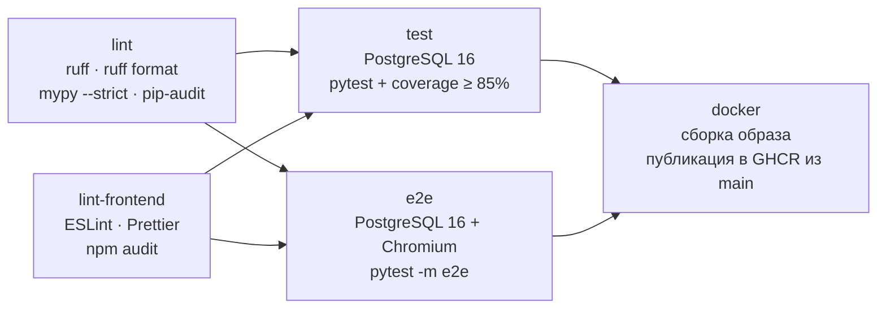

# Тестирование и метрики

## Уровни тестов

| Уровень | Каталог | Что проверяет | Нужно |
|---|---|---|---|
| Unit | `tests/unit` | Формулы ПР1, правила A01–A03 и их пороги, JWT и хеширование, ограничение попыток, разбор ответов FACEIT, разбор ника и ссылки | - |
| API (интеграционные) | `tests/api` | Эндпоинты через HTTP-клиент FastAPI на реальном PostgreSQL: коды ответов, права доступа, правила целей, сравнение и сводка, раздача интерфейса и CSP | PostgreSQL |
| Контракт | `tests/api/test_contract.py` | `docs/openapi.json` совпадает с кодом; миграции совпадают с моделями; цикл миграций upgrade → downgrade → upgrade | PostgreSQL |
| Сквозные (e2e) | `tests/e2e` | Настоящий API на uvicorn + Chromium: пользовательский путь, состояния ошибок и пустых данных, адаптив 360/768/1440, отсутствие горизонтальной прокрутки, размер кнопок, нарушения CSP | PostgreSQL, Chromium |
| Статический анализ | CI | ruff (с правилами bandit), mypy strict, ESLint, Prettier, pip-audit, npm audit | - |

Внешний FACEIT в тестах не вызывается. HTTP-клиент проверяется на подменённых ответах (`respx`),
API и интерфейс - на встроенных демо-профилях.

Контрольные расчёты выполняются независимо от `app/services/metrics.py`: в `test_stats.py` и
`test_analytics.py` - прямым подсчётом по исходным матчам из API (требование DoD ПР1 «сверка с
независимым контрольным расчётом»). Правила A01–A03 проверены на значениях ровно на пороге, ниже
порога, на неполной выборке и при отсутствии обязательного поля (ПР1, раздел 2.1).

## Набор тестов

| Файл | Тестов | Покрываемые требования |
|---|---|---|
| `unit/test_metrics.py` | 17 | Доля побед, K/D, пропуски ≠ 0, деление на ноль, изменение в п.п. |
| `unit/test_rules.py` | 28 | Группы 20/20 без пересечения (сбой 10.2), A01 60→45 срабатывает / 60→50 нет, A02 1,20→1,05 / 1,20→1,10, A03 4 из 10 / 3 из 9, правила выбора карты, порядок и детерминизм сводки (S07–S10) |
| `unit/test_security.py` | 15 | Argon2id; отклонение просроченных, подделанных, `alg=none`, чужого алгоритма, без `exp`/`jti`; уникальный `jti`; rate limiter |
| `unit/test_faceit_client.py` | 16 | Разбор профиля и истории, 404 → «не найден», 401/429/5xx → «недоступен», ключ не утекает |
| `unit/test_parse_query.py` | 12 | Ник или ссылка (S01); чужие домены и опасные символы отклоняются |
| `api/test_auth.py` | 17 | Регистрация, вход, выход с отзывом токена, 401, 409, 422 без эха пароля, 429, удаление аккаунта, заголовки, CORS |
| `api/test_players.py` | 13 | CRUD игроков, 404/409/503 (S01), синхронизация без дублей, IDOR |
| `api/test_stats.py` | 10 | Обзор = контрольный расчёт (S02), выборка 18 из 20, < 20 матчей, фильтры и границы (S04), покрытие |
| `api/test_analytics.py` | 13 | Сравнение = контрольный расчёт, фильтр карты до разбиения, неполная метрика (S07); карты (S08); A01 и A03 на контрольных данных, «нет сигналов», «недостаточно данных» (S09, S10); IDOR |
| `api/test_goals.py` | 14 | CRUD целей, одна активная (S11), 422 при нехватке данных, прогресс: collecting / ready / incomplete_data / unrecoverable (S12), IDOR |
| `api/test_ui_static.py` | 5 | Интерфейс раздаётся, CSP без inline-кода, 404 в формате problem+json |
| `api/test_contract.py` | 3 | Спецификация и схема БД соответствуют реализации |
| **Итого без e2e** | **163** | |
| `e2e/test_ui.py` | 9 | Основной сценарий целиком; рекомендация → цель и явная замена (S10, S11); готовая динамика цели (S12); пустой ввод, «не найден», 503 с «Повторить», нет матчей CS2, неверный пароль (S01); адаптив 360/768/1440 и кнопки ≥ 44 px (S05); истёкшая сессия; < 40 матчей |
| **Всего** | **172** | |

## Запуск

```bash
docker compose up -d db
```

Тесты без браузера:

```bash
pytest --cov=app --cov-report=term-missing
```

Сквозные тесты (один раз установить браузер):

```bash
pip install -e ".[dev,e2e]"
python -m playwright install chromium
pytest -m e2e tests/e2e
```

Все проверки разом с отчётом в `reports/summary.md` и скриншотами в `reports/screenshots/`:

```bash
python scripts/collect_reports.py --load-url http://localhost:8000
```

На Windows всё то же с нуля (контейнер БД, окружение, зависимости, Chromium) - одной командой:

```powershell
powershell -ExecutionPolicy Bypass -File scripts\verify.ps1
```

Строка подключения к тестовой БД задаётся переменной `TEST_DATABASE_URL`. По умолчанию это база
`faceit_test` контейнера `db`, которую создаёт `docker/initdb/01-test-db.sql`. Перед каждым тестом
API таблицы очищаются.

## Прогон в конвейере

Workflow `.github/workflows/ci.yml`, запускается на push в `main` и на каждый pull request:



Падение любого шага останавливает следующие. Отчёты JUnit XML и coverage.xml сохраняются
артефактом `test-reports`, скриншоты e2e - артефактом `e2e-screenshots`, сводная таблица
выводится в Summary прогона.

## Протокол прогона

| № | Дата | Окружение | Набор | Результат | Покрытие строк | Время |
|---|---|---|---|---|---|---|
| 1 | 28.10.2026 | Windows 11, Python 3.13.7 | `tests/unit` | 57 из 57 | - | 1,7 с |
| 2 | 28.10.2026 | + PostgreSQL 16 в Docker | полный | 110 из 111: `test_baseline_respects_map_context` | 95% | 12,9 с |
| 3 | 28.10.2026 | то же | полный | 111 из 111 | 95% | 12,8 с |
| 4 | 28.10.2026 | `docker compose up` (образ API + БД) | сквозной демо-сценарий через HTTP | 14 из 14 проверок | - | - |
| 5 | 29.10.2026 | Linux, Python 3.13.18 | `unit/test_rules.py`, `unit/test_metrics.py` (R2) | 45 из 45 | - | 0,2 с |
| 6 | 29.10.2026 | Linux, Node 22 | ruff check / format, ESLint, Prettier | 0 замечаний | - | - |
| 7 | 29.10.2026 | Linux, Chromium | e2e-сценарии на макете API (отладка интерфейса до подключения к серверу) | 8 из 8; `test_goal_progress_ready` пишет в БД и на макете не запускался | - | - |

**Разбор провала в прогоне 2.** Сервис отработал правильно: на de_mirage у демо-игрока было 14 матчей
из 100, и цель в контексте карты вернула 422 «доступно 14». Ошибочным было допущение теста.
В демо-данные добавлена основная карта игрока (de_mirage - около трети матчей), после чего тест
проверяет то, что задумано: исходная выборка цели состоит только из матчей выбранной карты.

**Прогон 4** проходит сценарий из [demo.md](demo.md) на собранном контейнере: health и заголовки
безопасности, 401 без токена, игрок по ссылке, обзор и фильтр карты, 503 ≠ 404, цель и 409 на вторую,
IDOR → 404, подделанный токен → 401, перебор пароля → 429, готовый прогресс демо-цели
(45% → 60%, +15 п.п.) и неизменность сравнения при повторном запросе.

**Прогон 7** нужен был, чтобы отладить селекторы и состояния интерфейса до полного прогона;
показатели в нём не проверяются. Итоговый прогон всего набора на PostgreSQL выполняется командой
`python scripts/collect_reports.py` и в CI.

### Непокрытый код

| Модуль | Что не покрыто | Почему |
|---|---|---|
| `app/seed_demo.py` | весь скрипт | Подготовка демо-данных, проверяется прогоном 4 |
| `app/services/auth.py`, `goals.py`, `players.py` | ветки `IntegrityError` | Гонки параллельных запросов; итог защищён ограничениями БД |
| `app/core/errors.py` | обработчик 500 | Срабатывает только на непредвиденные ошибки |
| `app/main.py` | создание `HttpFaceitClient` | Нужен ключ FACEIT; сам клиент покрыт тестами на `respx` |

## Метрики качества

| Метрика | Порог | Где контролируется |
|---|---|---|
| Пройденные тесты (unit, API, контракт, e2e) | 100% | CI, шаги «Тесты» и «Сквозные тесты» |
| Покрытие строк `app/` | ≥ 85% | `--cov-fail-under=85` |
| Замечания ruff / mypy strict / ESLint / Prettier | 0 | CI, шаги линтеров |
| Известные уязвимости зависимостей | 0 | `pip-audit`, `npm audit` |
| Расхождение спецификации с кодом | 0 | `test_published_openapi_matches_code` |
| p95 открытия обзора при 20 пользователях (NFR02) | ≤ 2 с | `scripts/load_test.py` |
| Горизонтальная прокрутка на 360 / 768 / 1440 px (NFR01) | нет | e2e `test_responsive_layout` |
| Кнопки и поля меньше 44 px (S05, крит. 4) | 0 | e2e `test_responsive_layout` |
| Ошибки JS и нарушения CSP в сценариях | 0 | e2e, проверка `pageerror` и консоли |
