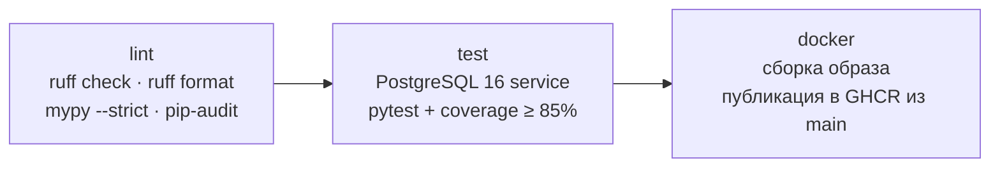

# Тестирование и метрики

## Уровни тестов

| Уровень | Каталог | Что проверяет | Нужна БД |
|---|---|---|---|
| Unit | `tests/unit` | Формулы ПР1, JWT и хеширование, ограничение попыток, разбор ответов FACEIT, разбор ника и ссылки | нет |
| API (интеграционные) | `tests/api` | Эндпоинты через HTTP-клиент FastAPI на реальном PostgreSQL: коды ответов, права доступа, правила целей | да |
| Контракт | `tests/api/test_contract.py` | `docs/openapi.json` совпадает с кодом; миграция совпадает с моделями; цикл миграций upgrade → downgrade → upgrade | да |

Внешний FACEIT в тестах не вызывается. HTTP-клиент проверяется на подменённых ответах (`respx`),
API - на встроенных демо-профилях.

Контрольные расчёты в `test_stats.py` выполняются независимо от `app/services/metrics.py`: прямым
подсчётом по исходным демо-матчам (требование DoD ПР1 «сверка с независимым контрольным расчётом»).

## Набор тестов

| Файл | Тестов | Покрываемые требования |
|---|---|---|
| `unit/test_metrics.py` | 17 | Доля побед, K/D, пропуски ≠ 0, деление на ноль, изменение в п.п.; контрольные примеры A01, A02 |
| `unit/test_security.py` | 12 | Argon2id; отклонение просроченных, подделанных, `alg=none`, чужого алгоритма, без `exp`; rate limiter |
| `unit/test_faceit_client.py` | 16 | Разбор профиля и истории, 404 → «не найден», 401/429/5xx → «недоступен», ключ не утекает |
| `unit/test_parse_query.py` | 12 | Ник или ссылка (S01); чужие домены и опасные символы отклоняются |
| `api/test_auth.py` | 14 | Регистрация, вход, 401, 409, 422 без эха пароля, 429, удаление аккаунта, заголовки, CORS |
| `api/test_players.py` | 13 | CRUD игроков, 404/409/503 (S01), синхронизация без дублей, IDOR |
| `api/test_stats.py` | 10 | Обзор = контрольный расчёт (S02), выборка 18 из 20, < 20 матчей, фильтры и границы (S04), покрытие |
| `api/test_goals.py` | 14 | CRUD целей, одна активная (S11), 422 при нехватке данных, прогресс: collecting / ready / incomplete_data / unrecoverable (S12), IDOR |
| `api/test_contract.py` | 3 | Спецификация и схема БД соответствуют реализации |
| **Итого** | **111** | |

## Запуск

```bash
docker compose up -d db
```

```bash
pytest --cov=app --cov-report=term-missing
```

Только unit-тесты (без БД):

```bash
pytest tests/unit
```

Строка подключения к тестовой БД задаётся переменной `TEST_DATABASE_URL`. По умолчанию это база
`faceit_test` контейнера `db`, которую создаёт `docker/initdb/01-test-db.sql`. Перед каждым тестом
API таблицы очищаются.

## Прогон в конвейере

Workflow `.github/workflows/ci.yml`, запускается на push в `main` и на каждый pull request:



Падение любого шага останавливает следующие. Отчёты JUnit XML и coverage.xml сохраняются
артефактом `test-reports`, сводная таблица выводится в Summary прогона.

## Протокол прогона

| № | Дата | Окружение | Набор | Результат | Покрытие строк | Время |
|---|---|---|---|---|---|---|
| 1 | 28.10.2026 | Windows 11, Python 3.13.7 | `tests/unit` | 57 из 57 | - | 1,7 с |
| 2 | 28.10.2026 | + PostgreSQL 16 в Docker | полный | 110 из 111: `test_baseline_respects_map_context` | 95% | 12,9 с |
| 3 | 28.10.2026 | то же | полный | 111 из 111 | 95% | 12,8 с |
| 4 | 28.10.2026 | `docker compose up` (образ API + БД) | сквозной демо-сценарий через HTTP | 14 из 14 проверок | - | - |

**Разбор провала в прогоне 2.** Сервис отработал правильно: на de_mirage у демо-игрока было 14 матчей
из 100, и цель в контексте карты вернула 422 «доступно 14». Ошибочным было допущение теста.
В демо-данные добавлена основная карта игрока (de_mirage - около трети матчей), после чего тест
проверяет то, что задумано: исходная выборка цели состоит только из матчей выбранной карты.

**Прогон 4** проходит сценарий из [demo.md](demo.md) на собранном контейнере: health и заголовки
безопасности, 401 без токена, игрок по ссылке, обзор и фильтр карты, 503 ≠ 404, цель и 409 на вторую,
IDOR → 404, подделанный токен → 401, перебор пароля → 429, готовый прогресс демо-цели
(45% → 60%, +15 п.п.) и неизменность сравнения при повторном запросе.

Ruff (lint и format), mypy `--strict` по `app/` и pip-audit (известных уязвимостей нет) пройдены без замечаний.

### Непокрытый код

| Модуль | Что не покрыто | Почему |
|---|---|---|
| `app/seed_demo.py` | весь скрипт | Подготовка демо-данных, проверяется прогоном 4 |
| `app/services/auth.py`, `goals.py`, `players.py` | ветки `IntegrityError` | Гонки параллельных запросов; итог защищён ограничениями БД |
| `app/core/errors.py` | обработчик 500 | Срабатывает только на непредвиденные ошибки |
| `app/main.py` | создание `HttpFaceitClient` | Нужен ключ FACEIT; сам клиент покрыт тестами на `respx` |

## Метрики качества

| Метрика | Порог | Где контролируется |
|---|---|---|
| Пройденные тесты | 100% | CI, шаг «Тесты» |
| Покрытие строк `app/` | ≥ 85% | `--cov-fail-under=85` |
| Замечания ruff / mypy strict | 0 | CI, шаг «Линтеры и типы» |
| Известные уязвимости зависимостей | 0 | `pip-audit` |
| Расхождение спецификации с кодом | 0 | `test_published_openapi_matches_code` |
